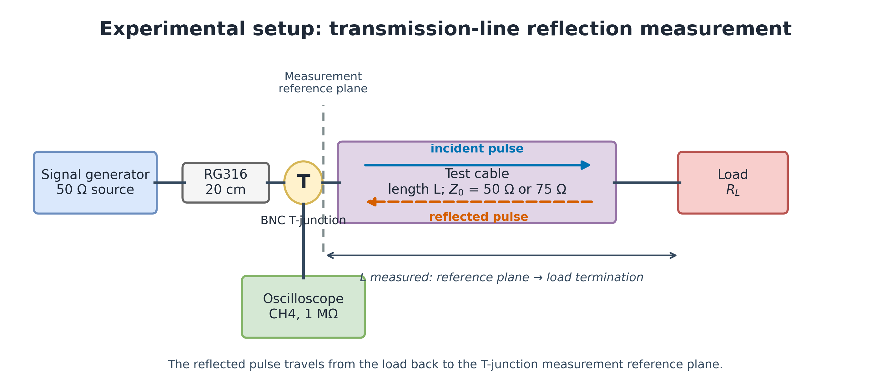
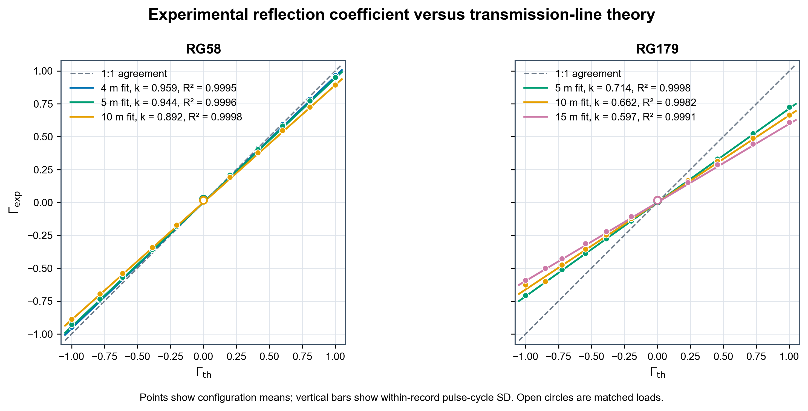
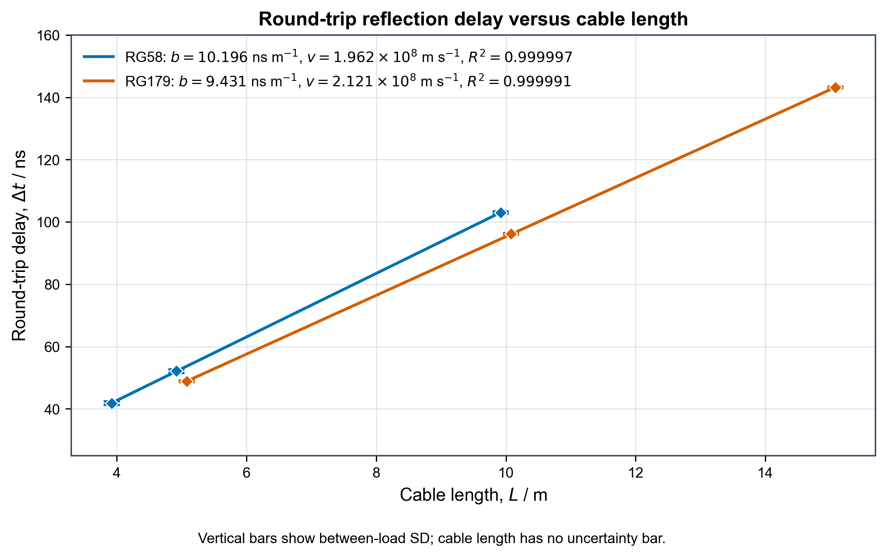

# Coaxial Cable Reflection Lab

同轴电缆脉冲反射实验的实测数据、处理脚本与离线交互可视化。比较 RG58（50 Ω）和 RG179（75 Ω）在不同电缆长度、终端负载下的反射系数及往返传播延迟。



## 快速浏览

- 下载仓库后，直接用浏览器打开 [`visualize/index.html`](visualize/index.html)。页面内嵌全部 **69 条有效波形、300,000 个采样点**，支持离线使用，无需启动服务器。
- [实测结果](docs/MEASUREMENTS.md)：六组反射拟合、传播速度及校准结果。
- [数据字典与处理方法](docs/DATA.md)：原始、处理后和手动对齐数据的区别。
- [发布与脱敏说明](docs/PUBLICATION.md)：脱敏范围、保留的数据及验证记录。

## 实验范围

| 电缆 | 标称特征阻抗 | 正式长度 |
|---|---:|---|
| RG58 | 50 Ω | 4、5、10 m |
| RG179 | 75 Ω | 5、10、15 m |

每组使用 6、12、22、33、50、75、120、200、470 Ω、开路和短路，共 **66 个正式配置**。每个配置来自一条采集记录；其中多个脉冲周期用于评估同一记录内的重复性，不视为独立实验重复。

根目录共 **71 个波形 CSV**：66 个正式配置、1 个直连校准、2 个 RG58 15 m 试测、2 个已弃用的 `*-WRONG.csv`。完整保留后两类文件用于审计，但正式分析排除它们。不同电缆的直接比较只适用于共有的 5 m 和 10 m 长度。

## 本地复现

建议 Python 3.11 或更新版本；本发布版验证环境为 Python 3.13。依赖范围见 [`requirements.txt`](requirements.txt)，本次验证的固定直接依赖版本见 [`requirements-tested.txt`](requirements-tested.txt)。

```sh
python -m venv .venv
# Windows PowerShell: .venv\Scripts\Activate.ps1
# Linux / macOS: source .venv/bin/activate
python -m pip install -r requirements.txt

python verify_waveform_data.py
python tools/validate_release.py
```

重新计算和生成图表：

```sh
python analyze_waveforms.py
python analysis/render_quantitative_figures.py
python visualize/visualize.py
python analysis/render_rg58_10m_waveform_figures.py
python analysis/render_aligned_waveform_composite.py
python analysis/render_aligned_full_record_composite.py
python analysis/render_experimental_setup_schematic.py
```

这些命令会覆盖各自生成的结果文件；原始波形 CSV 保持只读。`analyze_waveforms.py` 仅需 NumPy、Pillow；定量图和其他渲染脚本另需 Matplotlib。校验器及 HTML 生成器只使用 Python 标准库。图片排版可能随字体和库版本变化。

## 文件布局

```text
*.csv                        脱敏后的示波器导出、正式配置表和采样校验清单
analyze_waveforms.py          从原始记录提取幅度、50% 到达时刻并拟合
verify_waveform_data.py       结构、命名、覆盖范围及周期一致性校验
data_mark.py                 重新生成正式配置覆盖表
download_scope_waveform.ps1   可选：从仪器下载新波形
analysis/                    处理结果、校准、QC、绘图脚本与 PNG
visualize/                   完整数据 HTML、生成器、SVG 和手动对齐导出
docs/                        测量说明、数据字典、脱敏与历史记录
tools/                       发布数据完整性及隐私校验工具
```

## 图表





[`ln(k)` 与长度图](analysis/figures/ln_k_vs_length.png) 描述经验反射缩放因子的变化。其斜率是整个测量系统的有效衰减代理，不应直接当作单一频率下的电缆材料损耗。

## 可视化与手动对齐

页面可筛选波形、自动或手动调整时间、电压、baseline，计算匹配指标，并导出 JSON、CSV 和 PNG。界面中的对齐和启发式指标用于探索；**正式测量结果以 `analysis/processed_results.csv` 及其固定提取算法为准**。完整 HTML 包含两个 RG58 15 m 试测，排除了 `*-WRONG.csv`。

[`visualize/alignment.csv`](visualize/alignment.csv) 保存 RG58 10 m 十一个负载的人工调整参数；[`corrected_data.csv`](visualize/corrected_data.csv) 保存窗口内的变换后数据。两者不参与正式反射/延迟拟合。[操作说明](visualize/visualize.md)

## 可选仪器采集

需要自行提供仪器 IP；仓库不预设实验室地址。

```powershell
./download_scope_waveform.ps1 -ScopeIp '<instrument-ip>' -OutFile './new-waveform.csv'
```

此脚本会请求仪器生成 CSV、下载文件，并默认删除仪器端的临时导出文件；`-KeepRemoteFile` 可保留该文件。发布验证没有连接仪器或执行采集。

## 数据解释与限制

- `Γ_exp` 为每周期反射/入射幅度比的均值；`Δt` 为可分辨周期延迟的中位数。
- 六个匹配负载保留残余反射幅度，正式延迟标为 N/A；不强行为微弱反射赋予到达时间。
- 反射拟合固定零截距；报告 **centered R²**。匹配负载不参与该拟合。
- 延迟图的纵向误差棒为同组不同负载延迟的样本标准差；电缆长度没有记录测量误差，不添加横向误差棒。
- 每种电缆仅三个长度；很高的 R² 不代表传播速度具有同等精度。
- 波形可验证数值结构，不能单独证明当时连接的电缆或负载；物理标签的独立确认仍需要实验记录或完成的 manifest。

## 发布范围

不包含论文正文及原仓库 Git 历史。波形的仪器序列号已脱敏，采样行保持不变；提交使用通用维护者身份。旧工作记录放在 `docs/history/`，其中的历史状态和旧设置可能已被后续记录取代；当前结论以此 README 和 `analysis/` 为准。

License：尚未指定。
